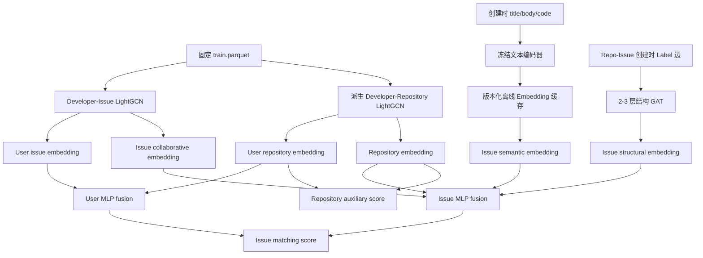

# 类 CODER 阶段 3～5：模块设计与训练流程

## 1. 实现状态与边界

本次完成了阶段 3～5 的模型、训练、缓存、评测和模型打包代码，但**没有使用 GFI-Bot 数据训练模型、没有执行 Transformer 编码、没有产生或声称任何真实模型指标**。

实现是面向 Developer–Issue–Repository 推荐的 CODER-inspired 设计，不是 CODER 论文官方实现或原数据集复现。阶段 5 的 Developer–Repository 边由 Issue 解决关系派生，只能解释为“项目级辅助传播或跨粒度约束”，不能解释为独立的 Star/Fork 多行为学习。

模型严格沿用阶段 2 的：

- 数据版本 `gfibot-m0-v1.1`；
- `fixed_train_graph` 切分；
- Developer、Issue、Repository、Label 连续 ID 映射；
- `historical_resolved_issue_subset` 候选协议；
- `same_repo` / `cross_repo` 候选模式；
- 已验证的阶段 2 候选 Parquet 和固定随机种子。

训练入口会校验 10 个阶段 1 输入文件和 5 个阶段 2 候选文件的 SHA-256。任何映射、切分、文本表、训练边或候选文件漂移都会在训练前失败。

## 2. 模块清单

| 模块 | 文件 | 职责 |
|---|---|---|
| 协同图 | `models/lightgcn.py` | Developer–Issue / Developer–Repository 归一化邻接矩阵、0～L 层平均、批量评分、向量导出、保存/加载 |
| 排序损失 | `training/losses.py` | BPR pairwise loss 和 `L_issue + λ_repo·L_repository` 多粒度目标 |
| 时序采样 | `training/negative_sampling.py` | 只从阶段 2 落盘的预测时刻可见候选中采样“未观察候选” |
| 文本切分 | `models/text_encoder.py` | 标题单段、正文段落、代码块切分和片段数量上限 |
| 冻结编码器 | `models/text_encoder.py` | 本地 CodeBERT/通用 Transformer 加载、冻结参数、masked mean pooling |
| Embedding 缓存 | `models/text_encoder.py` | 模型版本、revision、映射哈希、显式行映射、逐 Issue 文本哈希和行对齐缓存；只重编码变化行 |
| 结构图 | `models/gat.py` | Repository ↔ Issue ↔ Label 双向图和 2～3 层多头 GAT |
| 多粒度模型 | `models/coder.py` | 协同、语义、结构、项目表示的开关与 MLP 融合；Issue/Repository 分别评分 |
| 图构建 | `data/graph_builders.py` | 仅从训练边构建协同图；标签只读取创建快照 |
| 训练器 | `training/trainer.py` | Adam、确定性种子、联合 Issue/Repository BPR、验证选择适配器 |
| 训练配置 | `training/config.py` | 冻结输入校验、候选 Manifest 校验、训练参数解析 |
| 多粒度评测 | `evaluation/multigranular.py` | Issue/Repository 的 Recall、NDCG、MRR、Hit，以及冷启动和跨仓库分组 |
| 覆盖率 | `evaluation/groups.py` | 跨仓库用户识别和项目级模块实际覆盖率 |
| 安全训练入口 | `training/pipeline.py` | dry-run、验证集选参、测试门禁、模型打包和运行 Manifest |

统一配置位于 `CODER/configs/coder_multigranular.toml`，命令包装位于 `CODER/scripts/train_multigranular.py`。

## 3. 算法结构



### 3.1 Developer–Issue LightGCN

训练正边只来自训练期解决关系。对称归一化传播为：

```text
E^(l+1) = D^(-1/2) A D^(-1/2) E^l
E_final = mean(E^0, E^1, ..., E^L)
score(u, i) = <user_u, issue_i>
```

模型支持共享候选向量和 `[batch, candidates]` 两种批量评分，能够导出用户/Issue 向量，并将稀疏邻接矩阵、参数和配置一并保存。

### 3.2 时序 BPR

训练比较项直接来自阶段 2 的 `train_cross_repo.parquet`。采样器从每个训练查询当时的合法候选中，排除正例后按 `seed + epoch` 确定性采样。

```text
L_issue = -log sigmoid(score(u, positive_issue) - score(u, unobserved_issue))
```

这里的 comparison item 始终称为“未观察候选”，不解释为真实负反馈。

### 3.3 Issue 语义

输入只读取创建快照：

1. 标题生成独立 `[TITLE]` 片段；
2. fenced code block 生成 `[CODE]` 片段；
3. 其余正文按空行生成 `[TEXT]` 片段；
4. 截断到 `max_segments`；
5. 冻结 Transformer 编码每个片段，片段均值后 L2 归一化。

配置预留 CodeBERT 和通用句向量模型两项候选。两者必须分别产生验证集结果，再按验证指标选择；不能根据测试集选择编码器。

缓存 Manifest 包含：`dataset_version`、`mapping_sha256`、`model_name`、不可变 `revision`、维度、片段上限、行数和逐 Issue 文本 SHA-256。若所有字段及文本哈希一致，新运行直接复用；只对缺失或变化的行编码。

### 3.4 Repo–Issue–Label GAT

结构图使用：

```text
Repository ↔ Issue ↔ Label
```

Issue–Label 边只保留 `creation_snapshot`，避免关闭阶段标签泄漏。实现使用原生 PyTorch 的目标节点分段 softmax、multi-head attention 和 residual connection，不要求 `torch-geometric`。

### 3.5 跨粒度融合

```text
user = MLP([user_issue || user_repository])

issue = MLP([
    issue_collaborative
    || issue_semantic
    || issue_structural
    || repository_embedding
])
```

项目级正边由训练 Issue 的解决关系去重派生。联合 minibatch 中使用：

```text
L = L_issue + λ_repo · L_repository
```

若某个 Issue 查询的规范候选只映射到目标仓库，没有合法的其他仓库 comparison，则该查询只贡献 Issue loss，不虚构项目负例。

## 4. 实验变体

| 变体 | 协同 | 文本 | 结构 | 项目辅助 |
|---|---:|---:|---:|---:|
| `lightgcn` | ✓ |  |  |  |
| `coder_issue_text` | ✓ | ✓ |  |  |
| `coder_issue_structure` | ✓ |  | ✓ |  |
| `coder_issue_base` | ✓ | ✓ | ✓ |  |
| `coder_issue_repo` | ✓ | ✓ | ✓ | ✓ |

开关在模型构造时独立生效。所有变体使用相同切分、训练候选、验证候选、测试候选、ID 映射和指标实现。

主要对比顺序：阶段 2 Popularity / MF → LightGCN → Text / Structure 消融 → `coder_issue_base` → `coder_issue_repo`。

## 5. 如何准备环境

基础模型依赖已固定为 CPU PyTorch 2.9.0。先在仓库根目录执行：

```powershell
CODER/.venv/Scripts/python.exe -m pip install -e "CODER[test]"
```

需要训练文本变体时，再安装可选编码器依赖：

```powershell
CODER/.venv/Scripts/python.exe -m pip install -e "CODER[encoders]"
```

编码器默认 `allow_download = false`。训练机器必须事先将权重放入本地 Hugging Face 缓存或把 `name` 改为本地模型目录。配置已固定到官方仓库的不可变 revision：[CodeBERT `3b0952feddeffad0063f274080e3c23d75e7eb39`](https://huggingface.co/microsoft/codebert-base/tree/3b0952feddeffad0063f274080e3c23d75e7eb39)，[MiniLM `c21050a7ef692090620a6d037dd736908f9c7cf6`](https://huggingface.co/sentence-transformers/all-MiniLM-L6-v2/tree/c21050a7ef692090620a6d037dd736908f9c7cf6)。不要改用浮动的 `main` 作为正式实验版本；若主动更换编码器版本，应产生新的缓存版本和实验 run-id。

## 6. 如何训练

### 6.1 先做只读 dry-run

下面的命令只校验配置、数据哈希和共享候选哈希，**不会建立输出目录，也不会训练**：

```powershell
CODER/.venv/Scripts/python.exe CODER/scripts/train_multigranular.py `
  --config CODER/configs/coder_multigranular.toml `
  --variant lightgcn `
  --run-id dry-run-only
```

### 6.2 显式启动训练

只有加入 `--execute-training` 才会训练。每次使用新的 `run-id`，已有目录不会被覆盖：

```powershell
CODER/.venv/Scripts/python.exe CODER/scripts/train_multigranular.py `
  --config CODER/configs/coder_multigranular.toml `
  --variant lightgcn `
  --run-id lightgcn-v1 `
  --execute-training
```

依次训练消融和完整模型：

```powershell
$variants = @(
  "coder_issue_text",
  "coder_issue_structure",
  "coder_issue_base",
  "coder_issue_repo"
)

foreach ($variant in $variants) {
  CODER/.venv/Scripts/python.exe CODER/scripts/train_multigranular.py `
    --config CODER/configs/coder_multigranular.toml `
    --variant $variant `
    --run-id "$variant-v1" `
    --execute-training
}
```

不要并行启动多个文本变体首次编码同一个缓存目录。首次编码完成后，后续运行会复用缓存。

### 6.3 训练内部顺序

1. 校验 `gfibot-m0-v1.1` 和 15 份冻结输入/候选哈希；
2. 只用 `train.parquet` 构建 Developer–Issue 和派生 Developer–Repository 图；
3. 对文本变体准备或复用离线缓存；
4. 构建所选消融模型；
5. 对配置中的 embedding dimension、LightGCN 层数、学习率、GAT 层数、编码器和 `λ_repo` 做网格训练；
6. 每个候选模型只在 `valid_cross_repo` 上计算选择指标，默认是可预测用户 `NDCG@10`；
7. 冻结最佳参数并先保存模型包；
8. 冻结后才读取 test 候选，分别评估 Issue 和 Repository；
9. 单独输出 cold-start、warm-start、predictable、unpredictable 和 cross-repository-user 分组；
10. 输出项目模块覆盖率、训练历史、选择记录、向量和运行 Manifest。

测试集不能用来选择维度、层数、学习率、编码器、GAT 层数或 `λ_repo`。

## 7. 输出结构

```text
data/midterm/embeddings/gfibot-m0-v1.1/
  <encoder>@<revision>/
    embedding_manifest.json
    issue_embeddings.npy
    row_mapping.npy

data/models/gfibot-m0-v1.1/coder/<run-id>/
  model_manifest.json
  feature_schema.json
  weights.pt
  embeddings.npz

data/runs/gfibot-m0-v1.1/coder/<run-id>/
  validation_selection.json
  metrics.json
  comparison.json
  project_coverage.json
  run_manifest.json
  _SUCCESS | _FAILED
```

`model_manifest.json` 强制记录 `model_version`、`dataset_version`、`graph_version`、`encoder_version`、`profile_mode` 和 `coverage_state`。模型分数是匹配分，不是成功解决概率。

## 8. 验收与当前证据

当前只进行了安全验证，不是正式实验：

- LightGCN 归一化传播、层平均、批量评分、向量导出、保存和加载通过合成图测试；
- BPR 与多粒度联合 loss 能反向传播并更新参数；
- 同一种子的一轮训练参数和 loss 可复现；
- 规范候选采样和项目候选派生可复现，且不会把正例采成 comparison；
- 文本分段包含标题、正文和代码块；缓存第二次运行不重复编码；
- GAT 和完整融合模型能前向、保存并加载；
- dry-run 已验证真实的冻结输入和候选，但没有创建训练运行目录；
- 未安装或下载任何 Transformer 权重，未使用真实数据训练。

正式训练完成后，无论项目模块相对 `coder_issue_base` 提升、持平还是下降，都应保留并报告真实结果，不得更换切分或测试集。

## 9. 已知限制

- 当前阶段只覆盖历史已知用户；完全未知用户画像融合属于阶段 6。
- 项目候选由相同的 Issue 候选映射得到；`same_repo` 的项目级场景通常只有一个仓库，应结合 `cross_repo` 结果解释。
- 首次 Transformer 编码会消耗较多 CPU/GPU 时间和磁盘，必须作为独立离线步骤执行。
- 默认配置是 CPU 安全配置。正式训练前应根据机器资源调整 `device`，但不要改变冻结数据和评估协议。
- 当前没有真实训练结果；文档中的所有验收证据均来自合成图测试和只读输入验证。
