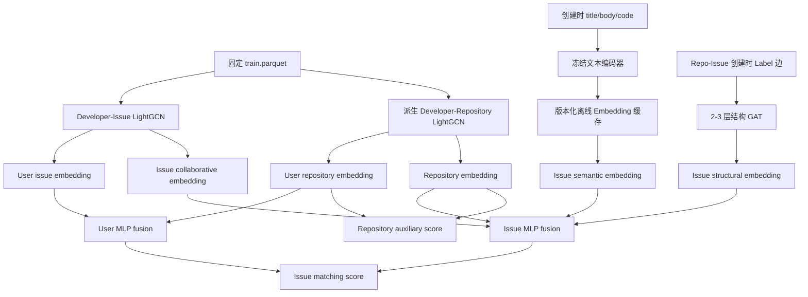

# 类 CODER 阶段 3～5：模块设计与训练流程

## 1. 实现状态与边界

阶段 3～5 的模型、训练、缓存、评测和模型打包代码已经完成。历史运行 `lightgcn-v1` 使用旧的“固定 50 Epoch 后单次验证”机制成功训练并保留为历史基线；后续运行使用周期性验证、最佳 Epoch checkpoint 和 Early Stopping。训练机制升级本身没有启动或冒充新的真实实验。

实现是面向 Developer–Issue–Repository 推荐的 CODER-inspired 设计，不是 CODER 论文官方实现或原数据集复现。阶段 5 的 Developer–Repository 边由 Issue 解决关系派生，只能解释为“项目级辅助传播或跨粒度约束”，不能解释为独立的 Star/Fork 多行为学习。

模型严格沿用阶段 2 的：

- 数据版本 `gfibot-m0-v1.1`；
- `fixed_train_graph` 切分；
- Developer、Issue、Repository、Label 连续 ID 映射；
- `historical_resolved_issue_subset` 候选协议；
- `same_repo` / `cross_repo` 候选模式；
- 已验证的阶段 2 候选 Parquet 和固定随机种子。

训练入口会校验 10 个阶段 1 输入文件和 5 个阶段 2 候选文件的 SHA-256。任何映射、切分、文本表、训练边或候选文件漂移都会在训练前失败。

## 2. 模块清单

| 模块 | 文件 | 职责 |
|---|---|---|
| 协同图 | `models/lightgcn.py` | Developer–Issue / Developer–Repository 归一化邻接矩阵、0～L 层平均、批量评分、向量导出、保存/加载 |
| 排序损失 | `training/losses.py` | BPR pairwise loss 和 `L_issue + λ_repo·L_repository` 多粒度目标 |
| 时序采样 | `training/negative_sampling.py` | 只从阶段 2 落盘的预测时刻可见候选中采样“未观察候选” |
| 文本切分 | `models/text_encoder.py` | 标题单段、正文段落、代码块切分和片段数量上限 |
| 冻结编码器 | `models/text_encoder.py` | 本地 CodeBERT/通用 Transformer 加载、冻结参数、masked mean pooling |
| Embedding 缓存 | `models/text_encoder.py` | 模型版本、revision、映射哈希、显式行映射、逐 Issue 文本哈希和行对齐缓存；只重编码变化行 |
| 结构图 | `models/gat.py` | Repository ↔ Issue ↔ Label 双向图和 2～3 层多头 GAT |
| 多粒度模型 | `models/coder.py` | 协同、语义、结构、项目表示的开关与 MLP 融合；Issue/Repository 分别评分 |
| 图构建 | `data/graph_builders.py` | 仅从训练边构建协同图；标签只读取创建快照 |
| 训练器 | `training/trainer.py` | Adam、确定性种子、联合 Issue/Repository BPR、验证选择适配器 |
| 训练配置 | `training/config.py` | 冻结输入校验、候选 Manifest 校验、训练参数解析 |
| 多粒度评测 | `evaluation/multigranular.py` | Issue/Repository 的 Recall、NDCG、MRR、Hit，以及冷启动和跨仓库分组 |
| 覆盖率 | `evaluation/groups.py` | 跨仓库用户识别和项目级模块实际覆盖率 |
| 训练选择控制 | `training/selection.py` | 周期验证、Early Stopping、原子 checkpoint、最佳 Epoch 恢复和恢复后分数校验 |
| 安全训练入口 | `training/pipeline.py` | dry-run、逐 Trial 最佳 Epoch/超参数选择、测试门禁、模型打包和运行 Manifest |

统一配置位于 `CODER/configs/coder_multigranular.toml`，命令包装位于 `CODER/scripts/train_multigranular.py`。

## 3. 算法结构



### 3.1 Developer–Issue LightGCN

训练正边只来自训练期解决关系。对称归一化传播为：

```text
E^(l+1) = D^(-1/2) A D^(-1/2) E^l
E_final = mean(E^0, E^1, ..., E^L)
score(u, i) = <user_u, issue_i>
```

模型支持共享候选向量和 `[batch, candidates]` 两种批量评分，能够导出用户/Issue 向量，并将稀疏邻接矩阵、参数和配置一并保存。

### 3.2 时序 BPR

训练比较项直接来自阶段 2 的 `train_cross_repo.parquet`。采样器从每个训练查询当时的合法候选中，排除正例后按 `seed + epoch` 确定性采样。

```text
L_issue = -log sigmoid(score(u, positive_issue) - score(u, unobserved_issue))
```

这里的 comparison item 始终称为“未观察候选”，不解释为真实负反馈。

### 3.3 Issue 语义

输入只读取创建快照：

1. 标题生成独立 `[TITLE]` 片段；
2. fenced code block 生成 `[CODE]` 片段；
3. 其余正文按空行生成 `[TEXT]` 片段；
4. 截断到 `max_segments`；
5. 冻结 Transformer 编码每个片段，片段均值后 L2 归一化。

配置预留 CodeBERT 和通用句向量模型两项候选。两者必须分别产生验证集结果，再按验证指标选择；不能根据测试集选择编码器。

缓存 Manifest 包含：`dataset_version`、`mapping_sha256`、`model_name`、不可变 `revision`、维度、片段上限、行数和逐 Issue 文本 SHA-256。若所有字段及文本哈希一致，新运行直接复用；只对缺失或变化的行编码。

### 3.4 Repo–Issue–Label GAT

结构图使用：

```text
Repository ↔ Issue ↔ Label
```

Issue–Label 边只保留 `creation_snapshot`，避免关闭阶段标签泄漏。实现使用原生 PyTorch 的目标节点分段 softmax、multi-head attention 和 residual connection，不要求 `torch-geometric`。

### 3.5 跨粒度融合

```text
user = MLP([user_issue || user_repository])

issue = MLP([
    issue_collaborative
    || issue_semantic
    || issue_structural
    || repository_embedding
])
```

项目级正边由训练 Issue 的解决关系去重派生。联合 minibatch 中使用：

```text
L = L_issue + λ_repo · L_repository
```

若某个 Issue 查询的规范候选只映射到目标仓库，没有合法的其他仓库 comparison，则该查询只贡献 Issue loss，不虚构项目负例。

## 4. 实验变体

| 变体 | 协同 | 文本 | 结构 | 项目辅助 |
|---|---:|---:|---:|---:|
| `lightgcn` | ✓ |  |  |  |
| `coder_issue_text` | ✓ | ✓ |  |  |
| `coder_issue_structure` | ✓ |  | ✓ |  |
| `coder_issue_base` | ✓ | ✓ | ✓ |  |
| `coder_issue_repo` | ✓ | ✓ | ✓ | ✓ |

开关在模型构造时独立生效。所有变体使用相同切分、训练候选、验证候选、测试候选、ID 映射和指标实现。

主要对比顺序：阶段 2 Popularity / MF → LightGCN → Text / Structure 消融 → `coder_issue_base` → `coder_issue_repo`。

## 5. 如何准备环境

基础模型依赖已固定为 CPU PyTorch 2.9.0。先在仓库根目录执行：

```powershell
CODER/.venv/Scripts/python.exe -m pip install -e "CODER[test]"
```

需要训练文本变体时，再安装可选编码器依赖：

```powershell
CODER/.venv/Scripts/python.exe -m pip install -e "CODER[encoders]"
```

编码器默认 `allow_download = false`。训练机器必须事先将权重放入本地 Hugging Face 缓存或把 `name` 改为本地模型目录。配置已固定到官方仓库的不可变 revision：[CodeBERT `3b0952feddeffad0063f274080e3c23d75e7eb39`](https://huggingface.co/microsoft/codebert-base/tree/3b0952feddeffad0063f274080e3c23d75e7eb39)，[MiniLM `c21050a7ef692090620a6d037dd736908f9c7cf6`](https://huggingface.co/sentence-transformers/all-MiniLM-L6-v2/tree/c21050a7ef692090620a6d037dd736908f9c7cf6)。不要改用浮动的 `main` 作为正式实验版本；若主动更换编码器版本，应产生新的缓存版本和实验 run-id。

## 6. 如何训练

### 6.1 先做只读 dry-run

下面的命令只校验配置、数据哈希和共享候选哈希，**不会建立输出目录，也不会训练**：

```powershell
CODER/.venv/Scripts/python.exe CODER/scripts/train_multigranular.py `
  --config CODER/configs/coder_multigranular.toml `
  --variant lightgcn `
  --run-id dry-run-only
```

### 6.2 显式启动训练

只有加入 `--execute-training` 才会训练。每次使用新的 `run-id`，已有目录不会被覆盖：

```powershell
CODER/.venv/Scripts/python.exe CODER/scripts/train_multigranular.py `
  --config CODER/configs/coder_multigranular.toml `
  --variant lightgcn `
  --run-id lightgcn-v2-earlystop `
  --execute-training
```

训练启动后会立即输出并持久化以下进度：

- 冻结输入哈希校验开始/完成；
- 建图、训练数据和规范候选加载阶段；
- 搜索网格总 trial 数及每个 trial 的完整参数；
- 每个 epoch 的开始、结束、loss、耗时和粗略剩余时间；
- 长 epoch 内的 batch 进度与累计 loss（默认最长静默 10 秒）；
- 周期验证分数、当前最佳 Epoch、Patience、Early Stopping、正式评测和导出阶段。

终端日志也会同步写入：

```text
data/runs/gfibot-m0-v1.1/coder/<run-id>/training.log
```

机器上的其他终端可实时观察：

```powershell
Get-Content data/runs/gfibot-m0-v1.1/coder/lightgcn-v2-earlystop/training.log -Wait
```

`_RUNNING` 现在是原子更新的 JSON 状态文件，包含 PID、当前 stage、trial、epoch、batch、累计耗时和最近更新时间。日志最大间隔由配置中的 `training.progress_interval_seconds` 控制，也可单次覆盖：

```powershell
CODER/.venv/Scripts/python.exe CODER/scripts/train_multigranular.py `
  --config CODER/configs/coder_multigranular.toml `
  --variant lightgcn `
  --run-id lightgcn-v2-earlystop `
  --progress-interval-seconds 5 `
  --execute-training
```

### 6.3 安全取消与状态判断

在前台训练终端按一次 `Ctrl+C`。入口会保存已有诊断和部分产物、删除 `_RUNNING`，并写入 `_CANCELLED`；正常结束写 `_SUCCESS`，异常结束写 `_FAILED`。三个终态文件均为 JSON，并记录耗时和最后进度。不要用任务管理器强杀，强杀无法执行状态收尾。

若终端或机器被强制关闭，可能遗留 `_RUNNING`。重新启动前先用其中的 PID 和更新时间确认进程确实不存在，再将对应 run/model 目录归档；训练器不会自动覆盖或删除已有实验目录。

依次训练消融和完整模型：

```powershell
$variants = @(
  "coder_issue_text",
  "coder_issue_structure",
  "coder_issue_base",
  "coder_issue_repo"
)

foreach ($variant in $variants) {
  CODER/.venv/Scripts/python.exe CODER/scripts/train_multigranular.py `
    --config CODER/configs/coder_multigranular.toml `
    --variant $variant `
    --run-id "$variant-v1" `
    --execute-training
}
```

不要并行启动多个文本变体首次编码同一个缓存目录。首次编码完成后，后续运行会复用缓存。

### 6.4 训练内部顺序

1. 校验 `gfibot-m0-v1.1` 和 15 份冻结输入/候选哈希；
2. 只用 `train.parquet` 构建 Developer–Issue 和派生 Developer–Repository 图；
3. 对文本变体准备或复用离线缓存；
4. 构建所选消融模型；
5. 对配置中的 embedding dimension、LightGCN 层数、学习率、GAT 层数、编码器和 `λ_repo` 做网格训练；
6. 每个 Trial 从指定 Epoch 开始周期性使用且只使用 `valid_cross_repo.parquet`，默认按可预测用户 `NDCG@10` 选择；
7. 验证严格改善时原子写入该 Trial 的最佳 checkpoint；相等时保留更早 Epoch；
8. Patience 按验证次数计算，满足最小训练轮数后可只提前结束当前 Trial；最大 Epoch 总会补一次验证；
9. 每个 Trial 结束后恢复最佳 Epoch，并复算验证指标检查 checkpoint 一致性；
10. 用各 Trial 的最佳验证分数选择全局最佳 Trial，重新构建相同配置并恢复其 checkpoint；
11. 再次验证恢复分数后，先冻结正式模型包；
12. 模型包冻结后才允许读取 test 候选，分别评估 Issue 和 Repository；
13. 单独输出 cold-start、warm-start、predictable、unpredictable 和 cross-repository-user 分组；
14. 输出项目模块覆盖率、训练/验证历史、选择记录、向量和运行 Manifest。

测试集不能用来选择维度、层数、学习率、编码器、GAT 层数或 `λ_repo`。

### 6.5 验证与 Early Stopping 配置

```toml
[training]
epochs = 50
validation_interval_epochs = 5
validation_start_epoch = 5
selection_metric = "ndcg@10"
early_stopping_enabled = true
early_stopping_patience = 5
early_stopping_min_delta = 0.0
early_stopping_min_epochs = 10
```

默认在 Epoch 5、10、15……验证；如果最大 Epoch 不落在该序列上，仍强制验证最后一个 Epoch。一次改善必须满足 `score > best_score + min_delta`，因此相同分数不会覆盖更早 checkpoint。Patience 是连续未改善的验证次数，而不是 Epoch 数。关闭 `early_stopping_enabled` 后仍执行周期验证和最佳 Epoch 选择，只是不提前结束 Trial。

Checkpoint 位于运行目录的 `checkpoints/trial-NNNN.best.pt`。文件通过“临时文件写完后原子替换”更新，保存完整 `state_dict`（包括 LightGCN、GAT、MLP、图邻接和相关 buffer）、模型配置、Epoch、验证分数与 Trial 元数据。由于本阶段不要求断点续训，不保存 optimizer 状态。

### 6.6 下一轮实验命令

LightGCN dry-run：

```powershell
CODER/.venv/Scripts/python.exe CODER/scripts/train_multigranular.py `
  --config CODER/configs/coder_multigranular.toml `
  --variant lightgcn `
  --run-id lightgcn-v2-earlystop
```

LightGCN 正式训练：

```powershell
CODER/.venv/Scripts/python.exe CODER/scripts/train_multigranular.py `
  --config CODER/configs/coder_multigranular.toml `
  --variant lightgcn `
  --run-id lightgcn-v2-earlystop `
  --execute-training
```

GAT 结构变体 dry-run：

```powershell
CODER/.venv/Scripts/python.exe CODER/scripts/train_multigranular.py `
  --config CODER/configs/coder_multigranular.toml `
  --variant coder_issue_structure `
  --run-id coder-structure-v1-earlystop
```

GAT 结构变体正式训练：

```powershell
CODER/.venv/Scripts/python.exe CODER/scripts/train_multigranular.py `
  --config CODER/configs/coder_multigranular.toml `
  --variant coder_issue_structure `
  --run-id coder-structure-v1-earlystop `
  --execute-training
```

## 7. 输出结构

```text
data/midterm/embeddings/gfibot-m0-v1.1/
  <encoder>@<revision>/
    embedding_manifest.json
    issue_embeddings.npy
    row_mapping.npy

data/models/gfibot-m0-v1.1/coder/<run-id>/
  model_manifest.json
  feature_schema.json
  weights.pt
  embeddings.npz

data/runs/gfibot-m0-v1.1/coder/<run-id>/
  checkpoints/
    trial-0001.best.pt
    ...
  validation_selection.json
  validation_history.json
  metrics.json
  comparison.json
  project_coverage.json
  run_manifest.json
  _SUCCESS | _FAILED | _CANCELLED
  training.log
```

`model_manifest.json` 强制记录 `model_version`、`dataset_version`、`graph_version`、`encoder_version`、`profile_mode` 和 `coverage_state`。模型分数是匹配分，不是成功解决概率。

## 8. 验收与当前证据

当前证据分为历史正式实验和本次机制测试：

- `lightgcn-v1` 是使用旧训练机制完成的历史正式运行，产物保持不变；
- 新 Early Stopping 机制只完成合成数据自动化测试和真实冻结输入 dry-run，尚未执行 `lightgcn-v2-earlystop` 或 `coder-structure-v1-earlystop`；

- LightGCN 归一化传播、层平均、批量评分、向量导出、保存和加载通过合成图测试；
- BPR 与多粒度联合 loss 能反向传播并更新参数；
- 同一种子的一轮训练参数和 loss 可复现；
- 规范候选采样和项目候选派生可复现，且不会把正例采成 comparison；
- 文本分段包含标题、正文和代码块；缓存第二次运行不重复编码；
- GAT 和完整融合模型能前向、保存并加载；
- dry-run 验证真实的冻结输入和候选时不会创建训练运行目录；
- 未安装或下载任何新的 Transformer 权重。

正式训练完成后，无论项目模块相对 `coder_issue_base` 提升、持平还是下降，都应保留并报告真实结果，不得更换切分或测试集。

## 9. 已知限制

- 当前阶段只覆盖历史已知用户；完全未知用户画像融合属于阶段 6。
- 项目候选由相同的 Issue 候选映射得到；`same_repo` 的项目级场景通常只有一个仓库，应结合 `cross_repo` 结果解释。
- 首次 Transformer 编码会消耗较多 CPU/GPU 时间和磁盘，必须作为独立离线步骤执行。
- 默认配置是 CPU 安全配置。正式训练前应根据机器资源调整 `device`，但不要改变冻结数据和评估协议。
- 当前没有真实训练结果；文档中的所有验收证据均来自合成图测试和只读输入验证。
