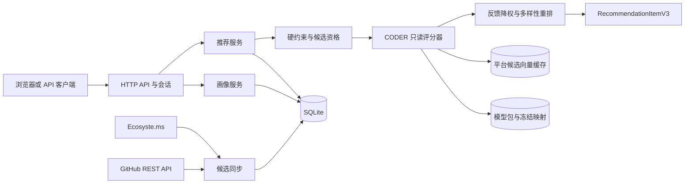
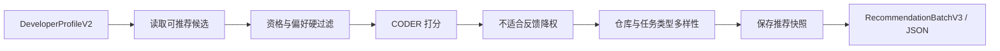

# OSS-Mentor

> 用开发者画像与 CODER 模型，为开源贡献者推荐真实、可解释的 GitHub Issue。

OSS-Mentor 面向刚开始开源贡献和希望继续成长的开发者。系统从公开数据源发现候选 Issue，经 GitHub 当前状态复核和任务特征抽取后，先执行语言、任务类型、操作系统、难度与可领取状态等硬约束，再由 CODER 模型排序，最后叠加用户反馈、多样性重排和可审计快照。

当前仓库是本地研究原型，不是托管在线服务，也不是 CODER 论文的官方实现或原数据集复现。

## 当前能力

- **真实候选池**：Ecosyste.ms 用于发现，GitHub REST API 用于当前状态、正文和关联 PR 复核，SQLite 保存运行时数据。
- **双通道画像**：支持 `newcomer`（新手破冰）和 `growth`（进阶成长），画像可由表单维护，也可在 GitHub OAuth 后导入有限的公开活动证据。
- **CODER 排序**：默认使用 `coder-full-search8-v1`，融合 Developer–Issue 协同表示、Issue 文本、Repository–Issue–Label 结构表示和 Repository 辅助表示。
- **安全推荐链路**：硬约束不会被模型分数突破；候选缓存缺失时返回错误，不会静默退回旧排序。
- **可解释与可追溯**：返回推荐理由、技能缺口、模型/数据/图/编码器版本、候选覆盖状态、反馈状态和推荐运行 ID。
- **本地网页与 API**：同一 Python 服务提供静态网页、画像、推荐、反馈、状态和 GitHub OAuth 接口。

## 文档导航

| 想了解什么 | 文档 |
|---|---|
| 系统模块、调用链和目录职责 | [系统架构](docs/architecture.md) |
| 当前数据、CODER 算法、训练结果和限制 | [数据与模型](docs/data-and-model.md) |
| 成员 B 输入、成员 D 输出及 HTTP API | [接口契约](docs/interfaces.md) |
| 安装、缓存、启动、训练恢复和测试 | [运行手册](docs/operations.md) |
| 文档维护规则和唯一入口 | [文档索引](docs/README.md) |

## 快速开始

### 1. 仅体验平台（无需 CODER 产物）

此路径使用明确的旧规则排序，只适合演示页面和接口；它不是当前正式算法。

```powershell
py -3.11 -m venv .venv
& '.\.venv\Scripts\python.exe' -m pip install -e .
& '.\.venv\Scripts\python.exe' -m oss_mentor init-demo
& '.\.venv\Scripts\python.exe' -m oss_mentor doctor
& '.\.venv\Scripts\python.exe' -m oss_mentor serve-api --legacy-ranking
```

浏览器访问 `http://127.0.0.1:8765/`。

### 2. 使用当前 CODER 模型

需要本机已有训练导出的模型、冻结映射和平台候选缓存。默认路径为：

```text
data/models/gfibot-m0-v1.1/coder/coder-full-search8-v1/
data/midterm/normalized/gfibot-m0-v1.1/mappings/
data/midterm/platform/coder-full-search8-v1/candidates.npz
data/oss_mentor.sqlite3
```

```powershell
& '.\CODER\.venv\Scripts\python.exe' -m pip install -e .
& '.\CODER\.venv\Scripts\python.exe' -m oss_mentor doctor
& '.\CODER\.venv\Scripts\python.exe' -m oss_mentor serve-api
```

`serve-api` 默认加载 CODER；任何必要产物缺失都会在启动时失败。自定义路径可使用 `--coder-model-dir`、`--coder-mapping-dir` 和 `--coder-candidate-cache`。

### 3. 让编码助手完成安装

可把下面这段话交给本地编码助手：

```text
请在 Windows PowerShell 中检查 Python 3.11+，安装根项目与 CODER 子项目的可编辑依赖；
不要下载或替换固定 MiniLM revision，不要启动训练。先运行 init-demo 和 doctor；
若 CODER 模型、映射或候选缓存缺失，只报告缺失项，不要伪造产物。
```

完整依赖、缓存生成和恢复命令见[运行手册](docs/operations.md)。

## 最小使用示例

### 查看健康状态

```powershell
Invoke-RestMethod 'http://127.0.0.1:8765/health'
Invoke-RestMethod 'http://127.0.0.1:8765/api/v1/status'
```

### 使用公开演示画像获取推荐

```powershell
Invoke-RestMethod `
  'http://127.0.0.1:8765/api/v1/recommendations?profile_key=newcomer_python_macos&limit=10'
```

### 使用一次性画像

```powershell
$body = @{
  profile = @{
    display_name = 'Python 新手'
    service_track = 'newcomer'
    preferred_languages = @('Python')
    operating_systems = @('windows')
    preferred_task_types = @('bug_fix', 'documentation')
    max_code_difficulty = 1
    max_setup_difficulty = 1
    desired_skill_stretch = 1
    skills = @{ python = 2; git = 1 }
  }
  limit = 10
} | ConvertTo-Json -Depth 6

Invoke-RestMethod `
  -Method Post `
  -Uri 'http://127.0.0.1:8765/api/v1/recommendations/custom' `
  -ContentType 'application/json' `
  -Body $body
```

## 系统架构



平台在线请求不会训练模型，也不会下载 Transformer。完整职责边界见[系统架构](docs/architecture.md)。

## 推荐工作流



1. B 侧提供规范化画像；登录用户额外提供 GitHub login 作为历史开发者查找键。
2. 平台只把当前可领取且满足画像门槛的任务交给模型。
3. CODER 对已知历史用户使用训练用户向量；未知用户暂用总体用户均值向量。
4. `not_suitable` 反馈在 Top-N 前降权，随后执行多样性重排并持久化快照。
5. D 侧通过服务契约或 HTTP API 消费结果，不能把 `score` 解释为完成概率。

## 当前模型结果

正式模型包 `coder-full-search8-v1` 使用 `gfibot-m0-v1.1`、固定 MiniLM revision 和 8 Trial 搜索；最佳 Trial 为 3，最佳 Epoch 为 45。

| 冻结评估切片 | NDCG@10 |
|---|---:|
| Valid / cross-repo / predictable（选模指标） | 0.386309 |
| Test / cross-repo / all | 0.215078 |
| Test / cross-repo / predictable | 0.358377 |
| Test / cross-repo / cross-repository-user | 0.383263 |
| Test / cross-repo / cold-start | 0.011400 |

这些是固定候选协议上的离线排序指标，不代表真实贡献成功率。当前结构图包含训练截止时间之后创建的结构节点，严格时序结论必须在新图版本重训后再给出；详见[数据与模型](docs/data-and-model.md)。

## 技术栈

| 层级 | 技术 | 用途 | 说明 |
|---|---|---|---|
| 平台 | Python 3.11+ 标准库 | CLI、HTTP 服务、采集与业务编排 | 根包无强制第三方依赖 |
| 存储 | SQLite；PostgreSQL schema | 本地运行时与可部署数据模型 | 当前推荐链路以 SQLite 为实装主路径 |
| 模型 | PyTorch 2.9、NumPy | LightGCN、GAT、融合与只读向量评分 | 模型推理不在线训练 |
| 文本 | Transformers 4.57、MiniLM L6 v2 | 创建时 Issue 文本向量 | revision 固定且默认禁止下载 |
| 数据 | PyArrow、Parquet | 冻结映射、交互、候选与评估 | 训练输入带 SHA-256 门禁 |
| 前端 | 原生 HTML/CSS/JavaScript | 登录、画像、推荐、反馈、状态页 | 无 Node 构建步骤 |
| 测试 | unittest、pytest、Node test | 平台、模型和浏览器网关回归 | 网络测试默认隔离 |

## 项目结构

```text
OSS-Mentor-main/
├── src/oss_mentor/       # 平台 CLI、API、画像、候选、推荐服务和存储
├── web/                  # 无构建步骤的网页与静态资源
├── db/                   # SQLite/PostgreSQL 迁移
├── config/               # 试点仓库与演示画像配置
├── fixtures/             # 脱敏演示数据库与接口 fixture
├── tests/                # 平台与接口回归测试
├── CODER/
│   ├── src/coder_issue/  # 数据准备、模型、训练、评估和只读推理
│   ├── configs/          # 冻结实验与搜索配置
│   ├── scripts/          # Preflight、缓存、训练、评估和比较入口
│   └── tests/            # CODER 回归测试
├── data/                 # 本地数据库、冻结中间产物、模型与运行结果（多数忽略）
├── docs/                 # 仅保留当前架构、数据模型、接口和运行文档
├── PRODUCT.md            # 产品边界和体验原则
└── README.md             # 项目总入口
```

## 配置

| 变量 | 必需 | 默认值 | 用途 |
|---|---|---|---|
| `GITHUB_TOKEN` | 网络同步时建议 | 空 | GitHub 公共数据只读访问 |
| `GITHUB_OAUTH_CLIENT_ID` | OAuth 时 | 空 | GitHub OAuth 应用 ID |
| `GITHUB_OAUTH_CLIENT_SECRET` | OAuth 时 | 空 | GitHub OAuth 密钥 |
| `OSS_MENTOR_SESSION_SECRET` | OAuth 时 | 空 | 本地会话签名密钥 |
| `OSS_MENTOR_BASE_URL` | 否 | 当前 host/port | OAuth 回调基地址 |
| `OSS_MENTOR_REPO_CONFIG` | 否 | `config/pilot_repositories_v0.1.csv` | 仓库清单 |
| `OSS_MENTOR_RAW_DIR` | 否 | `data/raw` | 原始响应目录 |
| `OSS_MENTOR_GITHUB_API_VERSION` | 否 | `2026-03-10` | GitHub REST API 版本 |
| `OSS_MENTOR_HTTP_TIMEOUT_SECONDS` | 否 | `30` | HTTP 超时 |
| `OSS_MENTOR_MAX_RETRIES` | 否 | `5` | 最大重试次数 |

完整变量见 [.env.example](.env.example)。真实密钥不得写入仓库。

## 测试

```powershell
# 平台
$env:PYTHONPATH = 'src'
python -m unittest discover -s tests -v

# CODER
& '.\CODER\.venv\Scripts\python.exe' -m pytest CODER\tests -q
```

测试默认不启动正式训练，也不访问 GitHub。模型与平台的定向测试命令见[运行手册](docs/operations.md)。

## 重要限制

- 未知登录用户尚未使用画像编码器，当前为 `cold_start_population` 总体向量回退。
- 平台候选的离线向量使用文本与已知 Repository 路径；协同和结构分量为零。
- 请求内模型原始点积分数经当前候选集合的 z-score 与 sigmoid 映射到 `0–1`，只能用于同次候选排序。
- 旧 OpenAPI 快照与当前路由不一致，已移除；现行 HTTP 契约以[接口契约](docs/interfaces.md)和代码为准。
- 当前 Dockerfile 没有复制 CODER 包和模型产物，不能直接承载默认 CODER 路径；容器化仍需补齐。
- 仓库暂未提供 `LICENSE`，不要假定其代码可按某种开源许可证再分发。

## Roadmap

- [x] 候选发现、GitHub 复核、SQLite 特征和双通道画像
- [x] CODER 8 Trial 训练、模型导出、平台候选缓存与默认评分接入
- [x] 登录画像、反馈闭环、多样性重排和推荐快照
- [ ] 画像感知的真正冷启动开发者编码器
- [ ] 严格训练截止时间过滤的结构图版本与统一重训
- [ ] 把 CODER 运行时、模型和健康检查纳入容器部署
- [ ] 从代码生成并校验完整 OpenAPI 文档
- [ ] 补充许可证与面向外部贡献者的发布流程

## 安全原则

- 默认只绑定 loopback；非本机地址必须显式 `--allow-remote`。
- 真实 token 只从环境变量读取，Raw 文件与日志不得保存凭证。
- OAuth 会话使用 `HttpOnly`、`SameSite=Lax` cookie；外部部署必须使用 HTTPS、受控 CORS 和独立密钥。
- 冻结数据、映射、候选和模型版本均需哈希校验，不得为了得到更好指标覆盖原版本。
