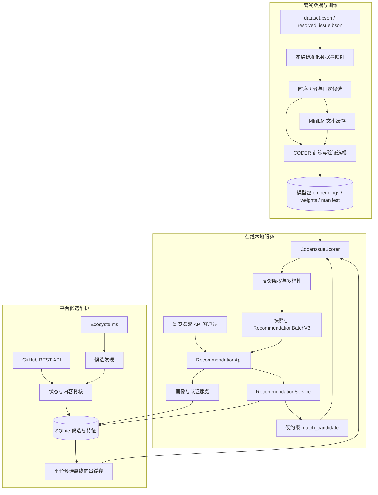
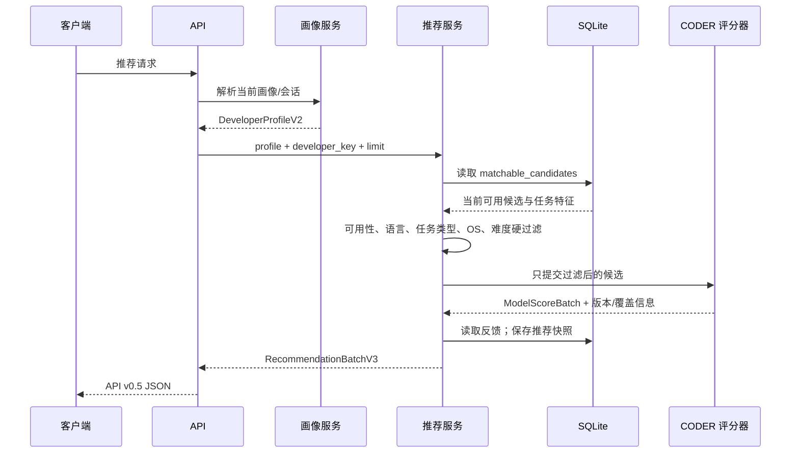

# 系统架构

## 1. 边界

OSS-Mentor 包含两个相互隔离但在推理期连接的子系统：

- **平台系统**：候选采集、GitHub 复核、画像、硬过滤、反馈、API、网页和运行时 SQLite；
- **CODER 研究系统**：冻结数据准备、候选协议、文本缓存、模型训练、评估、模型导出和只读评分。

平台请求只读取模型产物，不会启动训练、修改模型或下载 Transformer。

## 2. 整体架构



## 3. 运行时推荐链路



关键不变量：

1. `candidate_availability != available` 的任务不进入结果。
2. CODER 只替换通过硬过滤的候选排序分，不重新放入被过滤任务。
3. 评分器若漏掉任何合格候选会抛错，API 返回 `503 model_unavailable`。
4. `not_suitable` 降权和多样性发生在模型评分之后、Top-N 确定之前。
5. 推荐快照保存画像哈希、候选哈希、原始/最终排名和模型元数据。

## 4. 模块职责

| 模块 | 位置 | 职责 |
|---|---|---|
| CLI | `src/oss_mentor/cli.py` | 采集、同步、特征、评估、启动 API 和健康检查 |
| API | `src/oss_mentor/api.py` | HTTP 路由、校验、会话边界和兼容响应字段 |
| 共享契约 | `src/oss_mentor/contracts.py` | `DeveloperProfileV2`、`RecommendationItemV3`、枚举 |
| 推荐编排 | `src/oss_mentor/services/recommendation_service.py` | 硬过滤、模型调用、反馈、多样性、快照 |
| 模型端口 | `src/oss_mentor/model_scoring.py` | 平台与任意评分实现之间的传输无关协议 |
| CODER 评分器 | `CODER/src/coder_issue/inference/scorer.py` | 加载冻结向量、识别用户/Issue、返回排序分 |
| 平台候选缓存 | `CODER/scripts/prepare_platform_coder_cache.py` | 对训练图外的平台 Issue 生成只读向量 |
| CODER 训练 | `CODER/src/coder_issue/training/` | BPR 联合训练、周期验证、原子 checkpoint、恢复 |
| CODER 评估 | `CODER/src/coder_issue/evaluation/` | 冻结候选上的 Recall、Hit、NDCG、MRR 与分组 |
| SQLite 存储 | `src/oss_mentor/sqlite_store.py`、`storage/` | 候选、画像、会话、反馈、推荐运行 |
| 前端 | `web/` | 登录、画像、推荐、反馈和系统状态页面 |

## 5. 数据存储

### 平台运行时

`data/oss_mentor.sqlite3` 是当前本地服务主数据库。迁移位于 `db/sqlite/`，包含候选、特征、画像、反馈、GitHub 身份与会话、同步记录和推荐运行。`fixtures/oss_mentor_demo.sqlite3` 是脱敏演示源，`init-demo` 不会覆盖已有数据库。

### CODER 离线产物

```text
data/midterm/normalized/gfibot-m0-v1.1/  # 映射、交互、文本和图
data/runs/gfibot-m0-v1.1/                # 候选、训练状态、指标和 checkpoint
data/models/gfibot-m0-v1.1/              # 冻结模型包
data/midterm/embeddings/gfibot-m0-v1.1/  # 固定编码器文本缓存
data/midterm/platform/                    # 平台候选推理缓存
```

这些目录多数被 `.gitignore` 排除，不应假设全新 clone 自带模型或数据库。

## 6. 目录结构

```text
src/oss_mentor/
├── collector/            # Ecosyste.ms / GitHub 客户端与 Raw 保存
├── profiles/             # GitHub 公开证据、合并和画像服务
├── services/             # 认证、画像、推荐应用服务
├── storage/              # 存储协议和 SQLite 适配器
├── api.py                # HTTP 路由
├── cli.py                # 命令入口
├── contracts.py          # 跨模块公共契约
├── matching.py           # 硬门槛与旧可解释特征计算
└── model_scoring.py      # 模型评分端口

CODER/src/coder_issue/
├── data/                 # BSON 流式准备、规范化、时序切分和图构建
├── baselines/            # Popularity、文本相似度、BPR-MF
├── models/               # LightGCN、GAT、文本编码和多粒度融合
├── training/             # 训练、选模、恢复和 checkpoint
├── evaluation/           # 冻结协议评估和场景分组
└── inference/            # 平台只读评分器
```

## 7. 部署现状

本地 `serve-api` 是已验证主路径，默认只绑定 `127.0.0.1`。根项目没有 Web 框架依赖，使用标准库 HTTP Server。

`Dockerfile` 和 `compose.yaml` 保留平台 v0.5 的部署骨架，但镜像目前只复制根包，不含 `CODER/`、PyTorch/PyArrow 和模型产物；因此默认 CODER 模式不能直接由现有镜像启动。部署前需要把 CODER 运行时与只读产物显式装入镜像/卷，并为模型产物增加健康检查。

## 8. 扩展点

- 新评分模型实现 `ModelScorer.score()` 即可接入，不应绕过 `RecommendationService`。
- 新候选源应先写入统一候选存储并经过 GitHub 状态复核。
- 新图或数据版本必须创建新目录和 manifest，不覆盖 `gfibot-m0-v1.1`。
- 新 HTTP 字段应保持加法兼容，并同步更新 `contracts.py`、接口文档和测试。
