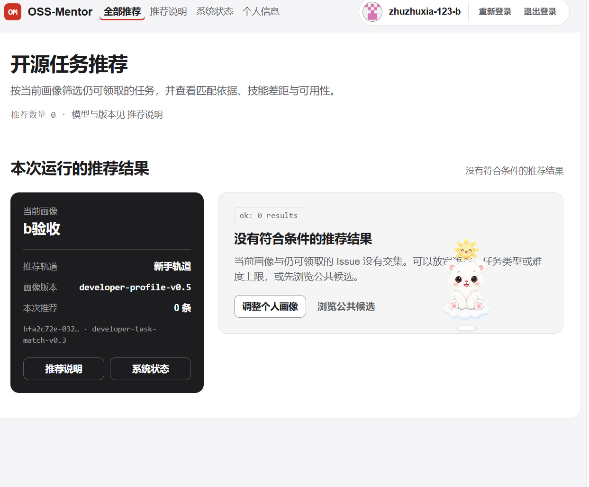

# B 侧画像与问卷闭环人工验收记录

日期：2026-11-10

验收人：成员 B

仓库基线：`main` / `5cd92ab1e68320d310853e278eefdc1c1b66ab61`

验收数据库：`data/manual_acceptance_b_20261110.sqlite3`

## 1. 验收目的

本次验收检查成员 B 负责的基础画像、成长问答、画像预览、逐项决定、正式确认、持久化、推荐门禁和登录隔离是否形成完整闭环。

本次不重复验收正式 CODER/gated 模型效果。正式在线库存、模型缓存和 `coder_gated` 运行链路已经由 PR #45 单独记录。

## 2. 运行边界

服务以独立 SQLite 数据库启动，关键状态为：

| 项目 | 本次状态 |
|---|---|
| OAuth | `oauth_configured=true` |
| 排序模式 | `ranking_engine=legacy` |
| 自动候选刷新 | `automatic_refresh_enabled=false` |
| 假定库存可用 | `inventory_availability_assumed=false` |
| 任务刷新 | `task_refresh_enabled=false` |
| 画像 adapter | `profile_adapter_configured=false` |
| 初始化候选数 | 48 |

`legacy` 排序仅用于验证确认画像能否被平台推荐接口消费，不用于宣称正式模型效果。

## 3. 人工操作与结果

| 步骤 | 验收操作 | 结果 |
|---|---|---|
| OAuth 登录 | 使用 GitHub OAuth 登录并返回 `/profile` | 通过 |
| 基础画像 | 保存 Newcomer、Python、Windows、Bug 修复/测试等基础信息 | 通过 |
| 刷新持久化 | 刷新页面后基础画像仍存在 | 通过 |
| 未确认门禁 | 画像未完成问卷确认时访问 `/recommendations` | 正确显示 `profile_not_confirmed` 引导 |
| 基础问卷 | 完成 8 个固定基础问题 | 通过 |
| 条件问卷 | 选择“问题复现与测试”后出现 2 个对应情境问题 | 通过，共显示 10 题 |
| 画像预览 | 点击“生成画像预览” | 通过，生成 19 项建议 |
| 逐项决定 | 对 19 项建议完成接受/拒绝选择 | 通过，达到 `19 / 19` |
| 正式确认 | 点击“确认并生成新版本” | 通过 |
| 确认后持久化 | 刷新后正式画像及当前版本仍存在 | 通过 |
| 增强画像出口 | 读取 `/api/v1/me/profile/enhanced-features` | 通过，返回 confirmed 画像 |
| 推荐门禁解除 | 确认后重新访问 `/recommendations` | 通过，不再出现 `profile_not_confirmed` |
| 正常空结果 | 当前画像与严格可领取候选无交集 | 正确显示 0 条结果，不是服务错误 |
| 退出登录 | 退出后访问 `/api/v1/me` 和增强画像出口 | 均返回 `401 authentication_required` |

## 4. 数据库持久化证据

验收完成后以只读方式检查独立 SQLite 数据库：

| 数据对象 | 数量 |
|---|---:|
| `profile_assessment_submission` | 1 |
| `profile_assessment_preview` | 1 |
| `profile_assessment_plan` | 1 |
| `profile_assessment_suggestion` | 19 |
| `profile_assessment_confirmation` | 1 |
| `profile_assessment_decision` | 19 |
| `developer_profile_feature_state` | 1 |
| `developer_profile_feature` | 23 |
| `developer_profile_current_feature` | 1 |

这说明页面预览、确认决定、正式版本和 23 维画像均已实际写入数据库，不是仅在浏览器中显示成功。

## 5. 推荐页验收截图

截图显示：

- 当前用户保持登录；
- 新手轨道和画像版本已被推荐页读取；
- 未确认画像门禁已解除；
- 推荐接口正常返回 `0 results`；
- 页面以“没有符合条件的推荐结果”展示空状态，而不是 `Failed to fetch` 或服务异常。

## 6. 结论与限制

成员 B 负责的“登录 → 基础画像 → 8＋2 问卷 → 画像预览 → 逐项接受/拒绝 → 正式确认 → 推荐消费 → 退出隔离”闭环人工验收通过。

本次 0 条推荐是独立验收库未启用在线库存刷新，且当前画像与严格可领取候选没有交集所形成的正常空结果。它不能解释为画像失败，也不能用于评价推荐模型效果。

本记录不包含 OAuth Client Secret、Cookie、Token、Authorization header 或完整身份 JSON。
