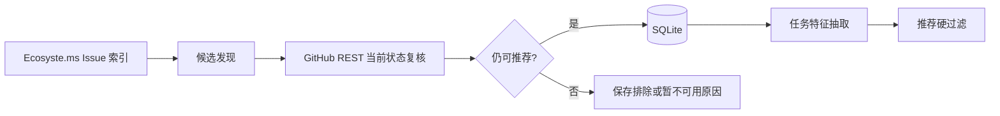
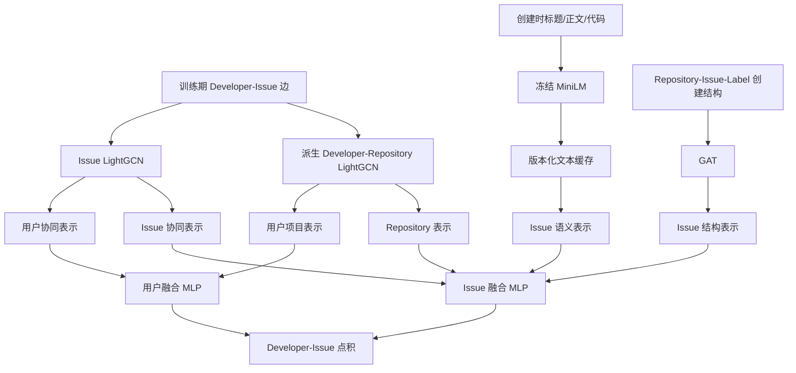

# 数据与模型

## 1. 两套数据不要混用

OSS-Mentor 同时存在平台运行时数据和 CODER 研究数据。它们用途、主键和更新方式不同。

| 范围 | 当前版本/位置 | 用途 | 是否在线更新 |
|---|---|---|---|
| 平台候选 | `data/oss_mentor.sqlite3` | 当前可推荐 Issue、任务特征、画像、反馈、推荐快照 | 可通过同步/刷新命令更新 |
| 演示数据 | `fixtures/oss_mentor_demo.sqlite3` | 无网络本地演示 | 只读种子 |
| CODER 原始研究数据 | `CODER/dataset.bson`、`resolved_issue.bson` | 历史开发者–Issue 解决关系及 Issue 信息 | 不在线更新 |
| CODER 冻结数据 | `gfibot-m0-v1.1` | 训练图、映射、文本、切分、候选和评估 | 不可原地修改 |
| 正式模型 | `coder-full-search8-v1` | 平台默认排序 | 只读 |
| 平台候选向量 | `data/midterm/platform/coder-full-search8-v1/candidates.npz` | 训练图外当前 Issue 的离线表示 | 候选变化后重新生成 |

平台 SQLite 的 `task_candidate_id` 与 CODER 的 `issue_id` 不是同一主键。推理时使用规范键 `repository.casefold()#issue_number` 对齐。

## 2. 平台候选数据

### 来源与刷新



- Ecosyste.ms 只用于发现和历史元数据，不作为最终实时真相。
- GitHub API 补齐正文、数字 Issue ID、当前状态、assignee、关联开放 PR 和仓库活跃性。
- 同步优先使用仓库配置中的新人友好标签，再用近期开放 Issue 补库存。
- 推荐只读取 `candidate_availability=available` 且完成必要特征的记录。

### 推荐需要的字段

| 字段组 | 关键字段 | 作用 |
|---|---|---|
| 身份 | `task_candidate_id`、`repository`、`issue_number` | 平台主键与 CODER 对齐 |
| 展示 | `title`、`html_url`、`body_text` | 页面和候选文本编码 |
| 资格 | `candidate_availability`、`github_verified_at`、`maintenance_status` | 可领取状态门禁 |
| 偏好 | `primary_language`、`task_types`、`operating_systems` | 画像硬过滤 |
| 难度 | `estimated_code_difficulty`、`estimated_setup_difficulty` | 难度上限 |
| 技能 | `requirements` | 技能覆盖与缺口解释 |
| 可解释特征 | `newcomer_score`、`growth_value_score`、`text_clarity_score` 等 | 理由和旧兼容评分 |

## 3. CODER 冻结数据

原始数据 manifest 为 `CODER/data_manifest.json`：

| 文件 | 大小 | SHA-256 |
|---|---:|---|
| `dataset.bson` | 7,043,563,852 B | `4cde2499108a3f85b92c82f92ff850644137f54c3c8bb4c86f4cd32997192039` |
| `resolved_issue.bson` | 658,228,041 B | `c6af28f9b7c13535dc15ae30c7b00df3ace76d15c39bae246f421e912f5d6638` |

标准化版本 `gfibot-m0-v1.1` 固定了：

- 18,360 个 Developer、148,096 个 Issue、97 个 Repository、6,768 个 Label；
- 连续 ID 映射、训练交互、创建时文本和创建时标签边；
- `fixed_train_graph` 图策略；
- `same_repo` 与 `cross_repo` 的 train/valid/test 固定候选；
- 训练及候选文件 SHA-256；
- 随机种子 `20261017`。

训练入口在建图或训练前核验冻结输入哈希；任何漂移都会失败。不得修改现有版本来“修正”数据，应创建新 dataset/graph version。

## 4. CODER-inspired 算法

本实现面向 Developer–Issue–Repository 推荐，不是 CODER 官方代码。



### 协同传播

Developer–Issue 和 Developer–Repository 使用 LightGCN：

```text
E^(l+1) = D^(-1/2) A D^(-1/2) E^l
E_final = mean(E^0, E^1, ..., E^L)
score(u, i) = <u, i>
```

### 文本与结构

- 标题、正文段落和 fenced code block 分段，最多 12 段。
- 编码器固定为 `sentence-transformers/all-MiniLM-L6-v2@c21050a7ef692090620a6d037dd736908f9c7cf6`，384 维，训练时冻结。
- 结构图为 `Repository ↔ Issue ↔ Label`，标签只读取创建快照。
- 文本缓存记录数据版本、映射哈希、模型 revision、逐 Issue 文本哈希与行映射，完整时直接复用。

### 联合目标

训练 comparison 来自预测时刻可见候选，未观察候选不能解释为真实负反馈。

```text
L_issue = -log sigmoid(s(u, issue+) - s(u, issue?))
L_total = L_issue + λ_repo × L_repository
```

Repository 正边由已解决 Issue 的 Repository 去重派生，是辅助传播/跨粒度约束，不是独立 Star/Fork 多行为学习。

## 5. 正式训练与模型包

配置 `CODER/configs/coder_full_search8.toml` 使用 CPU、最多 50 Epoch、每 5 Epoch 验证、8 个预注册 Trial，并以 `valid/cross_repo/predictable NDCG@10` 选模。

正式成功运行：

| 项目 | 值 |
|---|---|
| Run / model version | `coder-full-search8-v1` |
| Variant | `coder_issue_repo` |
| 最佳 Trial / Epoch | 3 / 45 |
| Embedding dim | 32 |
| Issue / Repository layers | 4 / 2 |
| Structure layers / heads | 2 / 2 |
| Learning rate | 0.005 |
| Repository loss weight | 0.1 |
| 终态 | `_SUCCESS`，8 Trial，最大 Epoch 完成 |

模型包包含：

```text
data/models/gfibot-m0-v1.1/coder/coder-full-search8-v1/
├── model_manifest.json
├── feature_schema.json
├── weights.pt
└── embeddings.npz
```

`model_manifest.json` 是推理版本真相，记录 model、dataset、graph、encoder、profile mode、选中参数和 checkpoint。

## 6. 离线评估

| Split / candidate mode / group | Recall@10 | MRR@10 | NDCG@10 |
|---|---:|---:|---:|
| Valid / cross_repo / predictable | 0.694065 | 0.291972 | 0.386309 |
| Test / cross_repo / all | 0.375036 | 0.165994 | 0.215078 |
| Test / cross_repo / predictable | 0.622911 | 0.277112 | 0.358377 |
| Test / cross_repo / cross_repository_user | 0.626850 | 0.307780 | 0.383263 |
| Test / cross_repo / cold_start | 0.022719 | 0.008059 | 0.011400 |
| Test / same_repo / all | 0.440574 | 0.178804 | 0.239754 |

当前每个 Query 只有一个正样本，因此 Recall@K 与 Hit@K 数值相同。Valid predictable NDCG@10 是选模指标；其余是冻结模型后的报告指标。

## 7. 平台推理策略

### 用户表示

- 若登录用户的 `developer_key`（当前传 GitHub login）存在于冻结 `developer_mapping.parquet`，使用对应训练用户向量，`profile_mode=known_history`。
- 否则使用所有训练用户向量均值，`profile_mode=cold_start_population`，并返回 `coder_unknown_developer_population_fallback` 警告。
- 画像目前只参与平台硬过滤，不进入 CODER 用户向量计算。

### Issue 表示

- 训练映射内 Issue 直接使用模型导出的 Issue 向量，`coverage_state=fixed_train_graph`。
- 平台新 Issue 使用离线候选缓存，`coverage_state=platform_candidate_cache`。
- 平台缓存向量采用文本语义和已知 Repository 表示；协同与 GAT 结构输入为零。
- 候选没有训练向量也没有缓存向量时，整个请求失败，不产生部分排序。

### 分数含义

评分器先计算用户与 Issue 向量点积，再在**本次请求候选集合内**做 z-score 和 sigmoid 映射。返回 `score ∈ [0,1]` 便于排序和现有契约消费，但它不是全局可比概率，候选集合变化会改变映射值。

## 8. 已知研究风险

1. **严格时序结构可见性**：当前 GAT 图包含训练截止日 2021-01-01 之后创建的 19,882 个 Issue 结构边和 22,732 条创建时标签边。没有使用关闭结果字段，但不满足严格时间顺序结构可见性。
2. **冷启动较弱**：离线 test/cross_repo/cold_start NDCG@10 为 0.011400；平台均值向量回退不是画像感知冷启动。
3. **Repository 协议**：Repository 分支是辅助训练模块，尚无独立冻结的 Repository 推荐评估协议。
4. **平台外样本近似**：新 Issue 没有协同和结构表示，只能使用文本与已知 Repository 路径。
5. **在线效果未验证**：目前没有可公开宣称的真实用户成功率或 A/B 结果。

这些风险不能通过修改现有冻结版本消除。后续必须创建新的 graph/model version，在同一公平预算下重训并重新报告。
