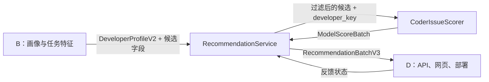

# 平台接口契约

本文给出当前 CODER 接入中成员 B 的输入、推荐模块的评分边界，以及成员 D 可消费的服务/HTTP 输出。代码真相位于：

- `src/oss_mentor/contracts.py`
- `src/oss_mentor/model_scoring.py`
- `src/oss_mentor/services/recommendation_service.py`
- `src/oss_mentor/api.py`
- `CODER/src/coder_issue/inference/scorer.py`

## 1. 职责划分



| 角色 | 必须提供/负责 | 不应负责 |
|---|---|---|
| B | 规范化画像、任务特征、技能与难度、候选可用性 | 直接调用训练代码或自行解释模型分数 |
| C/推荐模块 | 硬过滤后的模型排序、反馈、多样性、快照和契约对象 | 绕过资格门禁、在线训练、修改冻结输入 |
| D | 会话身份、HTTP 校验、页面展示、错误处理、部署与监控 | 接受客户端指定的登录用户 ID、静默回退旧算法 |

## 2. B → 推荐模块输入

### `DeveloperProfileV2`

```python
DeveloperProfileV2(
    profile_key: str,
    display_name: str,
    service_track: Literal['newcomer', 'growth'],
    preferred_languages: tuple[str, ...],
    operating_systems: tuple[str, ...],
    preferred_task_types: tuple[str, ...],
    max_code_difficulty: int,       # 0..3
    max_setup_difficulty: int,      # 0..3
    desired_skill_stretch: int,     # 通常 0..2
    skills: dict[str, int],         # 技能等级 0..4
    profile_source: str = 'user',
    profile_version: str = 'developer-profile-v0.5',
)
```

约束：

- `service_track` 只能是 `newcomer` 或 `growth`；旧 `hybrid` 不在当前公共契约内。
- 技能名执行 `strip().casefold()`；归一化后同名但等级冲突会拒绝。
- 登录入口必须由服务端根据 session 读取当前用户画像，不能接收客户端提交的 owner/user ID。
- `developer_key` 不是画像字段；D 从已认证 GitHub 身份传入当前 `github_login`，用于查找历史用户向量。

### 候选任务

B/候选存储至少应为推荐链路提供：

```python
{
    'task_candidate_id': int,
    'repository': str,
    'issue_number': int,
    'title': str,
    'html_url': str,
    'body_text': str,
    'candidate_availability': 'available',
    'primary_language': str,
    'task_types': list[str],
    'operating_systems': list[str],
    'estimated_code_difficulty': int,
    'estimated_setup_difficulty': int,
    'requirements': list[dict],
    'github_verified_at': str | None,
    # 解释与兼容特征：newcomer_score、growth_value_score、
    # text_clarity_score、maintenance_status、has_contributing_guide 等
}
```

任务先经 `match_candidate(..., developer-task-match-v0.3)` 硬过滤。CODER 评分器自身只依赖 `task_candidate_id`、`repository` 和 `issue_number` 查向量，但这不意味着其他资格/解释字段可以省略。

## 3. 推荐模块 → CODER 评分端口

```python
class ModelScorer(Protocol):
    def score(
        self,
        *,
        profile: DeveloperProfileV2,
        developer_key: str | None,
        candidates: Sequence[dict[str, Any]],
    ) -> ModelScoreBatch: ...
```

当前 `CoderIssueScorer` 行为：

- `profile` 已由平台用于硬过滤，当前模型不直接编码画像；
- `developer_key` 命中映射时使用历史用户向量，否则使用总体均值；
- 每个候选必须返回一个 `ModelScore`，不允许部分结果；
- 不训练、不下载、不写模型文件。

```python
ModelScore(
    task_candidate_id: int,
    score: float,              # 0..1，请求内排序值
    coverage_state: str,       # fixed_train_graph | platform_candidate_cache
)

ModelScoreBatch(
    scores: tuple[ModelScore, ...],
    model_version: str,
    dataset_version: str,
    graph_version: str,
    encoder_version: str,
    profile_mode: str,         # known_history | cold_start_population
    warnings: tuple[str, ...],
)
```

## 4. 推荐模块 → D 输出

### `RecommendationItemV3`

| 字段 | 类型 | 说明 |
|---|---|---|
| `task_candidate_id` | int | 平台候选主键 |
| `repository_full_name` | string | `owner/repo` |
| `issue_number` | int | GitHub Issue 编号 |
| `title` / `html_url` | string | 展示与跳转 |
| `service_track` | string | `newcomer` 或 `growth` |
| `score` | float | `0..1` 请求内排序值，不是成功概率 |
| `difficulty` | object | `{code: 0..3, setup: 0..3}` |
| `matched_skills` / `missing_skills` | string[] | 技能覆盖解释 |
| `reasons` | object[] | 固定原因码、中文标签、证据、分值影响、特征版本 |
| `warnings` | string[] | 数据、覆盖或模型警告 |
| `availability` | string | 结果中必须为 `available` |
| `verified_at` | datetime/null | GitHub 最近复核时间 |
| `feedback_state` | string/null | `interested`、`not_suitable`、`started`、`completed` |

### `RecommendationBatchV3`

| 字段 | 说明 |
|---|---|
| `run_id` | 每次推荐的 UUID |
| `feedback_context` | 与反馈绑定的安全上下文 |
| `service_track` / `match_version` | 通道与硬过滤版本 |
| `profile_hash` / `candidate_hash` | 可复现性摘要 |
| `items` | 公共推荐项 |
| `rankings` | 原始/最终排名及 CODER 版本、覆盖信息 |
| `warnings` | 批次级警告 |
| `created_at` | UTC 生成时间 |

`rankings` 在 CODER 模式追加：

```json
{
  "task_candidate_id": 1,
  "raw_score": 73.2,
  "final_score": 73.2,
  "raw_rank": 1,
  "final_rank": 2,
  "diversity_reranked": true,
  "scoring_engine": "coder_issue_repo",
  "model_version": "coder-full-search8-v1",
  "dataset_version": "gfibot-m0-v1.1",
  "graph_version": "gfibot-m0-v1.1",
  "encoder_version": "sentence-transformers/all-MiniLM-L6-v2@c21050a7...",
  "profile_mode": "known_history",
  "coverage_state": "fixed_train_graph"
}
```

## 5. HTTP API

基础版本为 `v0.5`。所有 JSON 响应追加 `request_id`；错误形状为 `{"error":{"code","message","request_id"}}`。

| 方法与路径 | 认证 | 用途 |
|---|---|---|
| `GET /health` | 否 | 进程和数据库存在性 |
| `GET /api/v1/status` | 否 | 数据库、同步和候选池状态 |
| `GET /api/v1/profiles` | 否 | 公开演示画像 |
| `GET /api/v1/recommendations` | 否 | 按公开 `profile_key` 推荐 |
| `POST /api/v1/recommendations/custom` | 否 | 一次性画像推荐，不持久化画像 |
| `POST /api/v1/recommendation-options` | 否 | 当前画像组合的真实库存选项 |
| `GET /api/v1/me/recommendations` | 是 | 当前登录用户画像的 CODER 推荐 |
| `POST /api/v1/feedback` | 否/上下文约束 | 保存推荐反馈状态 |
| `GET /api/v1/feedback/summary` | 否 | 本地反馈漏斗与迁移统计 |
| `GET /api/v1/auth/github/start` | 否 | 创建 OAuth state/授权 URL |
| `GET /api/v1/auth/github/callback` | 否 | OAuth 回调并建立会话 |
| `POST /api/v1/auth/logout` | 可选会话 | 注销 |
| `GET /api/v1/me` | 是 | 当前用户公开信息 |
| `GET/PUT /api/v1/me/profile` | 是 | 读取或写入当前用户画像 |
| `POST /api/v1/me/profile/import-github` | 是 | 经同意导入有限公开 GitHub 证据 |
| `POST /api/v1/me/profile/suggestions/{id}/accept` | 是 | 接受画像建议 |
| `POST /api/v1/me/profile/suggestions/{id}/reject` | 是 | 拒绝画像建议 |

### 登录推荐响应

```json
{
  "profile": {
    "profile_key": "user-profile-key",
    "display_name": "Alice",
    "service_track": "growth",
    "profile_source": "user_input"
  },
  "items": [],
  "count": 0,
  "feedback_context": "user:7:profile:user-profile-key",
  "run_id": "uuid",
  "match_version": "developer-task-match-v0.3",
  "warnings": [],
  "rankings": [],
  "api_version": "v0.5",
  "request_id": "uuid"
}
```

响应中的 `track`、`repository`、`match_score`、`skill_coverage`、`maximum_skill_gap` 和 `skill_gaps` 是为旧网页保留的加法别名；新接入应优先消费 `RecommendationItemV3` 原生字段。

## 6. 状态码与失败语义

| 状态 | 典型场景 |
|---|---|
| `400` | 查询、limit、画像或反馈上下文无效 |
| `401` | 未登录或会话失效 |
| `404` | 画像、任务或路由不存在 |
| `409` | 画像建议已处理等状态冲突 |
| `422` | 画像字段校验失败 |
| `502` | GitHub 上游错误 |
| `503 model_unavailable` | 模型/候选缓存无法完整评分 |
| `503 service_not_ready` | 数据库或服务配置不可用 |

D 侧应把 `503 model_unavailable` 显示为明确的模型/缓存故障，不要自动切换 `--legacy-ranking`。

## 7. 兼容性规则

- 公共字段只做加法演进；删除或改义需要新契约版本。
- `score` 始终为 `0..1`，旧页面 `match_score` 为 `0..100` 别名。
- 技能名以 casefold 后形式比较，显示名称可另行保留。
- `feedback_context` 由服务端构造并校验，不能接受任意用户范围字符串。
- 候选缓存、模型、数据集、图和编码器版本必须一起报告。
- 模型不可用时 fail closed；只有操作者显式传 `--legacy-ranking` 才使用旧规则排序。
